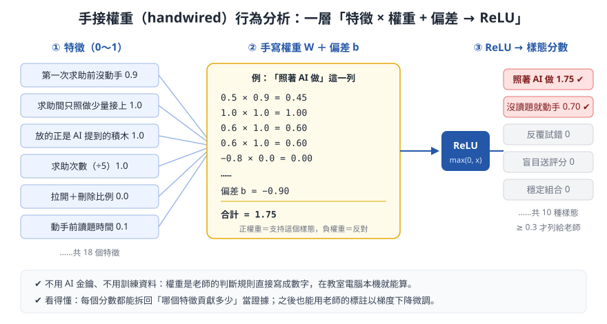

# Weight-Space × handwired：把規則直接寫成神經網路權重

本 repo 整理「**權重空間程式設計**（weight-space programming）」與 [chenglou/handwired](https://github.com/chenglou/handwired) 的做法，並記錄我們如何把它用在 [osep-judge](https://github.com/bai-collab/osep-judge-private) 的**學生學習行為分析**：不訓練、不需要 AI 金鑰，把老師的判斷規則直接寫成一層「特徵 × 權重 + 偏差 → ReLU」的小型網路。

- [1. 核心概念](#1-核心概念)
- [2. handwired 的做法](#2-handwired-的做法)
- [3. 我們的應用：osep-judge 學習行為分析](#3-我們的應用osep-judge-學習行為分析)
- [4. 與 handwired 原版的差異](#4-與-handwired-原版的差異)
- [5. 下一步：用老師的標註微調權重](#5-下一步用老師的標註微調權重)
- [6. 可執行範例](#6-可執行範例)
- [7. 參考資料](#7-參考資料)

---

## 1. 核心概念

一般的神經網路，權重是用大量資料**訓練**出來的。權重空間程式設計反過來：**權重由人直接寫出來**，寫進去的就是程式邏輯。網路照樣是「矩陣乘法 + 非線性」，所以：

| | 一般深度學習 | 權重空間程式設計／handwired |
| --- | --- | --- |
| 權重從哪來 | 用資料訓練 | 由程式邏輯直接決定 |
| 需要資料 | 需要大量資料 | 不需要 |
| 行為 | 近似、難解釋 | 跟原程式**完全一樣**，可以逐項解釋 |
| 可微分 | 是 | **仍然是**：之後可以解凍權重繼續訓練，或與其他網路一起端到端訓練 |

> ⚠️ 撰寫本文時，所在環境無法連線到 [Weight-Space Programming 原文](https://rikiyat.github.io/blog/weight-space-programming/)，因此本節只寫概念層次，**沒有引用原文的細節**；詳細內容請以原文為準。handwired 的部分則根據其 GitHub README 整理。

## 2. handwired 的做法

handwired 的 README 開宗明義：「Turn your regular JavaScript code into a neural net; no training, exact, yet also fully differentiable!」

### 2.1 用 ReLU 做出「如果」
ReLU 就是 `Math.max(0, x)`。兩個 ReLU 相減就能做出階梯函數，例如整數 `a`：

```js
// a > 4 時是 1，否則是 0
Math.max(0, a - 4) - Math.max(0, a - 5)
```

### 2.2 if-else：兩個分支都算，再選
原本「依條件只走一條路」，改成**兩個分支都算**，再用上面的 0/1 指示值，透過乘法與加法選出結果：

```js
// 原本：if (a > 4) return a * 2; else return a + 10;
const cond = Math.max(0, a - 4) - Math.max(0, a - 5);
return cond * (a * 2) + (1 - cond) * (a + 10);
```

### 2.3 整個程式只剩「乘、加、ReLU」
依 README 的說法，handwired 把程式轉成浮點數上的矩陣乘法加 ReLU，最後收成一個大矩陣運算，可以用一般 JS 或 WebGPU 執行。因為只剩這兩種基本運算：

- 整個程式**可微分**；
- GPU 常用的最佳化（融合、稀疏、重排）都用得上；
- 可以**解凍權重**讓程式透過訓練改變行為，或把凍結的程式接在一般神經網路上**端到端訓練**。

### 2.4 示範（見 [chenglou.me/handwired](https://chenglou.me/handwired)）
- **HandwiredOS**：視窗拖曳、動畫等桌面操作轉成神經網路運算。
- **Learned Gallery**：解凍原本固定的權重，讓程式透過訓練改變行為。
- **JSON Search**：用 WebGPU 平行處理 10 萬份 JSON 文件，毫秒級搜尋。

授權：MIT（依其 repo 標示）。

## 3. 我們的應用：osep-judge 學習行為分析

[osep-judge](https://github.com/bai-collab/osep-judge-private) 是給國中小學生的 Scratch 解題平台，附有 AI 解題導師。我們想知道學生是**自己思考**，還是**照著 AI 做**、**沒讀題就動手**、**把評分當猜答案**，又不想把學生資料都丟給大型語言模型去判斷。

做法就是 handwired 的精神：**把老師的判斷規則直接寫成權重**。



### 3.1 輸入：18 個特徵（都壓到 0～1）
從學生的操作紀錄算出，例如：

| 來源 | 特徵舉例 |
| --- | --- |
| 積木拖曳軌跡 | 操作量、拉開＋刪除比例、接上比例、最長停頓、2 秒內連續操作比例 |
| 與 AI 的互動 | 第一次求助前有沒有動手、求助間只照做少量接上的比例、**放的積木正是 AI 提到的比例**、AI 建議沒被採用的比例 |
| 評分 | 幾乎沒操作就評分、未滿分後再評分的次數、**1 分鐘內只小改就再評分的比例** |
| 讀題 | 動手前讀題時間、說明分頁累計時間、**劃記數量**、**劃記蓋到題目關鍵處的比例** |

把數值壓到 0～1 本身也用 ReLU：`clamp01(x) = relu(x) − relu(x − 1)`。

### 3.2 一層手寫網路：`score = relu(W · f + b)`
- **W** 的每一列是一種樣態，正權重＝支持、負權重＝反對；**b** 是偏差（門檻）。
- 共 **10 種樣態**：穩定組合、反覆試錯、停滯卡關、少量操作就評分、持續修正、**照著 AI 做**、**AI 建議沒被採用**、**盲目送評分**、**有仔細讀題**、**沒讀題就動手**。
- 分數 ≥ 0.3 才列給老師，並附上 `W_ij × f_j` 最大的幾項當「主要依據」。

例：「照著 AI 做」這一列

| 特徵 | 權重 W | 特徵值 f | 貢獻 |
| --- | ---: | ---: | ---: |
| 第一次求助前沒動手 | 0.5 | 0.9 | 0.45 |
| 求助間只照做少量接上 | 1.0 | 1.0 | 1.00 |
| 放的正是 AI 提到的積木 | 0.6 | 1.0 | 0.60 |
| 求助次數（÷5） | 0.6 | 1.0 | 0.60 |
| 拉開＋刪除比例 | −0.8 | 0.0 | 0.00 |
| 偏差 b | | | −0.90 |
| **relu(合計)** | | | **1.75 → 列出** |

### 3.3 為什麼適合教育現場
- **不用金鑰、不用網路、不用訓練資料**：教室電腦本機即時算出。
- **看得懂**：每個分數都能拆回「哪個特徵貢獻多少」，老師可以檢查判斷是否合理。
- **保留學習能力**：形式可微分，之後能用老師的標註微調（見第 5 節）。
- **能回到教學**：判斷結果會即時調整 AI 導師的引導方式，例如判為「照著 AI 做」時，導師改成先請學生自己猜。

### 3.4 程式位置（osep-judge）
- 分析核心：`scripts/tutor/behavior-analysis.mjs`（`FEATURES`、`WEIGHTS`、`BIASES`、`PATTERNS`、`TUTOR_NUDGES`）
- 積木軌跡記錄：`src/lib/learning-records.js`
- 題目劃記與讀題：`src/lib/problem-reading.js`
- 說明與畫面：osep-judge README 的「學習行為分析（handwired 手接權重）」一節

## 4. 與 handwired 原版的差異

| | handwired | osep-judge 行為分析 |
| --- | --- | --- |
| 輸入 | 任意 JS 程式 | 從學習紀錄算出的 18 個特徵 |
| 轉換方式 | 編譯器自動把程式轉成權重 | 人直接寫權重表（`WEIGHTS`） |
| 網路結構 | 多層，可表達迴圈、狀態 | 單層 `relu(W·f + b)` |
| 輸出 | 與原程式完全相同的結果 | 樣態分數（越過門檻才列出） |
| 目標 | 精確執行程式，並保留可訓練性 | 可解釋的規則判斷，並保留可訓練性 |

簡單說：我們用的是 handwired **最基本的那一招**（用 ReLU 寫規則、保留可微分），規模小很多，但足以讓判斷規則透明、可校準。

## 5. 下一步：用老師的標註微調權重

規則的權重是起始值。計畫在教師頁加上「同意／誤判」按鈕，累積標註 `y ∈ {0, 1}` 後：

- 對單一樣態 `s = relu(z)`、`z = W·f + b`，當 `z > 0` 時 `∂s/∂W_i = f_i`、`∂s/∂b = 1`。
- 用平方誤差 `(s − y)²` 做梯度下降，就能把權重往老師的判斷靠近。
- 為了保持可解釋，可以限制權重的正負號不變，或加上「離手寫起始值不要太遠」的正則化。

收集真實課堂資料的注意事項與待辦，記在 osep-judge README 的「待辦：收集學生作答資料後的後續開發」。

## 6. 可執行範例

> 延伸：[handwired × Sprite 方法](docs/sprite-biomech-method.md)，把神經節律、肌肉、關節、骨架、蒙皮到像素化整條鏈寫成手寫網路，範例在 `node examples/sprite-arm-chain.mjs`。

```bash
node examples/handwired-basics.mjs
```

[`examples/handwired-basics.mjs`](examples/handwired-basics.mjs) 不需要任何套件，示範：

1. 用 ReLU 做出階梯函數；
2. 把 if-else 改寫成「兩個分支都算再選」，並驗證與原程式結果完全相同；
3. `clamp01`；
4. 用 `relu(W·f + b)` 判斷「照著 AI 做」，並列出每個特徵的貢獻；
5. 用一筆老師標註做一步梯度下降。

## 7. 參考資料

- chenglou. (n.d.). *handwired* [Computer software]. GitHub. https://github.com/chenglou/handwired ——本文 handwired 做法的依據，含 ReLU 條件式寫法與示範說明。
- chenglou. (n.d.). *Handwired demos*. https://chenglou.me/handwired ——HandwiredOS、Learned Gallery、JSON Search 線上示範。
- rikiyat. (n.d.). *Weight-space programming*. https://rikiyat.github.io/blog/weight-space-programming/ ——權重空間程式設計原文；撰寫本文時無法連線，未引用其細節。
